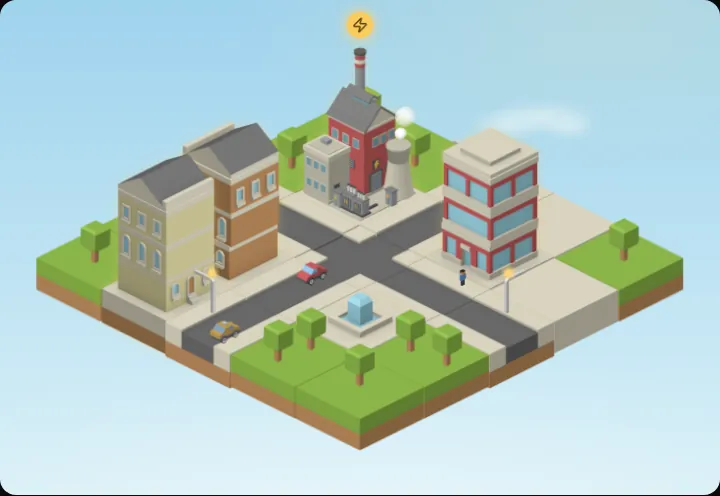
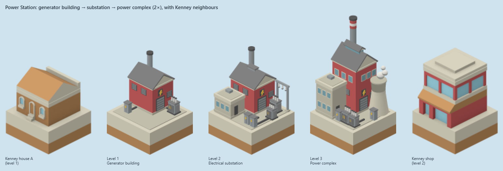
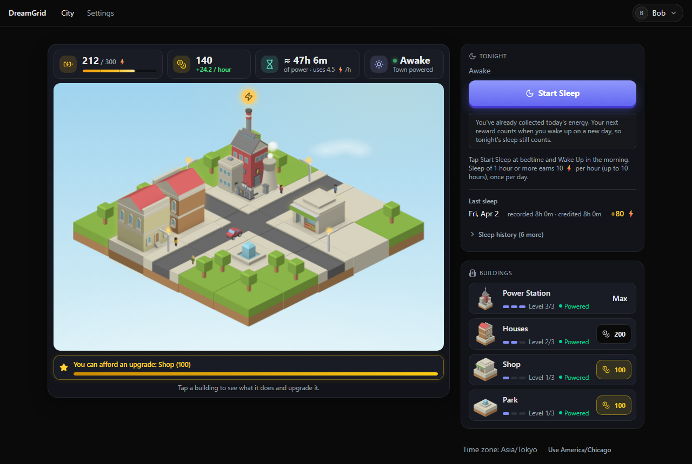
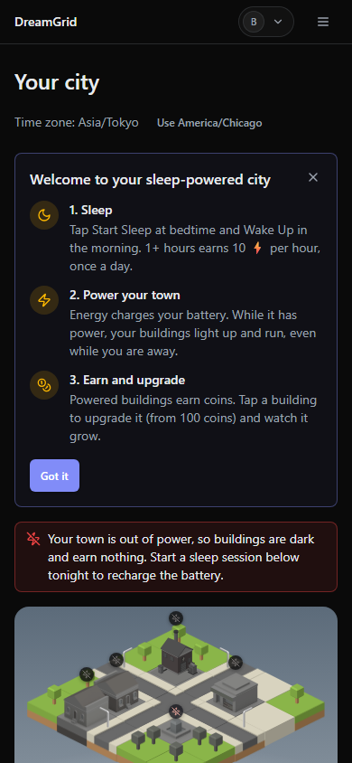
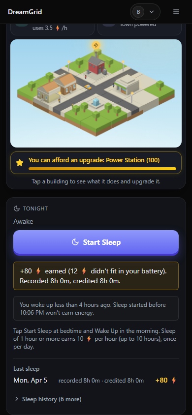
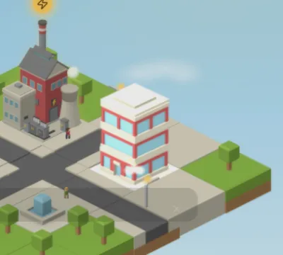
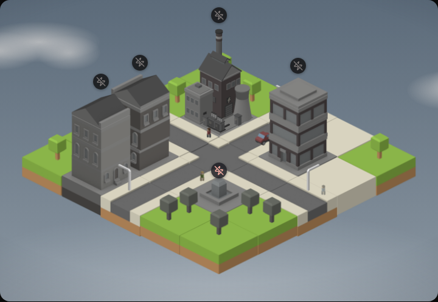

# DreamGrid

**Sleep well. Power your city.** DreamGrid is a small idle game about rest. When you go to bed you start a sleep session, and when you wake up your sleep becomes electricity. That electricity runs a miniature isometric town, which earns coins while it has power. You spend the coins upgrading the town's buildings.

Live: **https://dreamgrid.app.space** · Built on the DeepSpace SDK (Cloudflare Workers + Durable Objects).



```
Sleep ──▶ Energy ──▶ Powered city ──▶ Coins ──▶ Upgrades
  ▲                                                │
  └──── a bigger Power Station turns sleep into more energy ◀┘
```

## How to play

1. **Sleep.** Tap **Start Sleep** at bedtime and **Wake Up** in the morning. A session of at least 1 hour earns 10 ⚡ for every credited hour, up to 10 hours. Time is credited in 15-minute steps, and you can earn one reward per local day.
2. **Power your town.** Energy charges the Power Station's battery (100 / 200 / 300 ⚡ by level). While the battery has charge, the buildings run, the streetlights glow and the town earns money, even while you're away.
3. **Earn and upgrade.** Powered buildings produce coins. Tap a building to see what it does and upgrade it: 100 coins for level 2, 200 coins for level 3.

| Building | What it does per level |
|---|---|
| Power Station | Bigger battery (100/200/300 ⚡) and a sleep-energy bonus (+0/20/40%) |
| Houses | +5 coins/h, uses 1 ⚡/h |
| Shop | +12 coins/h, uses 2 ⚡/h |
| Park | +10% to all coin income, uses 0.5 ⚡/h |

When the battery runs dry, the town goes dark. The buildings dim and show "no power" badges, coins stop, and the page tells you to sleep to recharge. Every balance number lives in one file: [`src/game/config.ts`](src/game/config.ts).

## Screenshots

| | |
|---|---|
|  |  |
| The Power Station grows: generator building → substation → power complex | The game HUD: battery, coins per hour, power left and sleep status above the town, with the next goal below it |
|  |  |
| First visit: a three-step how-to-play card and an out-of-power warning | Waking up: the energy you earned, and when the next reward is possible |
|  |  |
| An upgrade, celebrated: the new building rises into place with sparkles and dust | Out of power: overcast sky, dark buildings, no steam, dimmed streets |

More screenshots are in [`docs/screenshots/`](docs/screenshots/README.md).

## Architecture

```
src/
  game/        Pure rules, shared by server and browser: config, sleep, economy, time, guidance
  actions/     Server actions (the only way state changes): sleep, upgrades, city store
  schemas/     DeepSpace record collections and their RBAC permissions
  city/        The isometric scene: projection, layout, sprite stacking (no canvas, plain )
  components/  React UI: the game HUD (ResourceHud, BuildingTiles), CityScene + CityLife,
               SleepPanel, UpgradePanel, HowToPlay, TimezoneSetting
  pages/       Static landing (prerendered) + the signed-in app under (app)/
tools/sprite-pipeline/   Dev-only three.js renderer for the original Power Station art
```

### The server decides

The browser never says how long you slept or how many coins you have. It sends **Start Sleep**, **Wake Up**, **Cancel** or **Upgrade X**, and the worker does the rest:

- **Server time only.** Session durations come from the worker's clock, never the client's.
- **Exactly-once rewards from unique constraints.** DeepSpace has no multi-record transactions, so the guarantees rest on `uniqueOn` inserts, which the Durable Object refuses to duplicate:
  - one open session per player
  - one outcome (wake XOR cancel) per session
  - one paid reward per player per local day
- **Append-only city state.** Each city change inserts revision *N+1* of the full city state (`city_mutations`, unique on `userId + revision`). The insert is the compare-and-swap. Two simultaneous upgrades can't spend the same coins, and an older state can never overwrite a newer one.
- **Offline earnings settled once.** Every city change first settles the elapsed time with `settle(city, now)`: power runs until the battery is empty, and coins accrue only for powered hours. The browser runs the same pure function each second to animate the numbers. The server re-checks everything.
- **Crash-safe closes.** Waking up is *decide, then finish*. Each finish step is idempotent, so a retry, the other button or the next Start Sleep completes a close that crashed midway.
- **Private by default.** Cities and sleep records are `read: 'own'`, and clients can't write them directly. Server actions verify ownership even though server tools bypass RBAC.
- **Anti-farming rules** (in `config.ts`):
  - at least 1 hour of sleep before a session earns anything
  - a 10-hour credit cap
  - one reward per local day
  - a 4-hour gap between rewarded sessions
  - the time zone can change at most once a week

  The UI explains these up front (`src/game/guidance.ts`) so players aren't surprised. The guidance is display-only.

### Dev-only tools that production can't reach

A simulated clock, fault injection and a city-state setter make the edge cases testable: the 4-hour gap, day rollover, crash recovery and a dead battery. They work only when `ALLOW_DEBUG_ROUTES=true` **and** the worker has no production service bindings, so even a misconfigured deploy can't let players time-travel ([`src/actions/devtools.ts`](src/actions/devtools.ts)). The UI for these tools is tree-shaken out of production builds.

## Art

- **Kenney isometric packs (CC0).** Buildings are stacked from separate ground, floor and roof sprites, so an upgrade adds a storey and changes the façade ([`src/city/sprites.ts`](src/city/sprites.ts)). License: [`public/sprites/LICENSE-kenney.txt`](public/sprites/LICENSE-kenney.txt).
- **The Power Station is original art** made for this project. A dev-only three.js pipeline ([`tools/sprite-pipeline`](tools/sprite-pipeline/README.md)) renders it in Kenney's exact projection, palette and shading. It was calibrated against a Kenney tile to 98.5% silhouette overlap. Its three levels are one building growing: a generator building, then an electrical substation, then a power complex. three.js is a dev dependency only and never ships to players.
- **Citizens** are original pipeline art too, because Kenney's packs have no people. The **taxi and red sedan** are from Kenney's Isometric Vehicles pack.
- The scene is plain `` elements sorted with the painter's algorithm and positioned in percentages, so it scales down to a 360 px phone without a canvas.

### The game HUD

The city page is laid out like a mobile city-builder. The town sits in a frame with four resource chips above it (battery, coins per hour, power left, awake/sleeping) and the next upgrade goal below it. The sleep controls and building tiles sit beside it, or below it on phones. The HUD only displays the live, settled city that `useLiveCity` computes each second. It never decides anything. The "+75 ⚡" pop appears only when a value jumps (a reward, a spend), never on the every-second ticks.

### Town life (decorative only)

Four citizens walk the sidewalks and two cars drive the roads. None of it has state, a database or gameplay effects.

- **Fixed routes as a pure timeline.** Each actor follows a fixed route of waypoints and pauses ([`src/city/life.ts`](src/city/life.ts)), so its pose is a pure function of the clock, with no pathfinding or AI. Unit tests check that:
  - walkers stay on the sidewalks and cars stay in their lanes
  - each sprite faces the way it moves
  - the two cars share one 26-second loop, phased so they only ever pass in opposite lanes
- **One animation loop.** A single `requestAnimationFrame` loop ([`CityLife.tsx`](src/components/city/CityLife.tsx)) moves six `<span>`s with compositor-only transforms; React doesn't re-render per frame. Every static node carries its painter's-order `z-index`, so moving sprites pass correctly behind and in front of buildings.
- **Ambient CSS animation:** swaying trees, drifting clouds, and steam from the Level 3 cooling tower (only while the town has power).
- **Upgrade celebration.** When a building is upgraded, it rises into place with sparkles once the upgrade panel closes.
- **The town reacts to its state:**
  - out of power: clouds turn grey and a cold vignette darkens the town
  - asleep: the citizens go home and only the night taxi drives
- **Cheap to run.** Everything pauses while the town is scrolled off-screen. Under `prefers-reduced-motion`, citizens stand still, cars stay away and nothing animates.

## Accessibility and mobile

- Each building in the town is a real button with a name ("Power Station: view and upgrade"), so the keyboard and screen readers can use it.
- Sleep and upgrade results are announced through live regions, and errors use `role="alert"`.
- The HUD gives every state in words as well as colour ("Powered" / "No power", "Out of power"). Gains and spends float a small "+75 ⚡" or "−100" over their counter, which is a one-off cue that stays still under reduced motion.
- Touch targets are at least 36 px. No layout scrolls horizontally at 360 px.
- Icons are `aria-hidden`, and every state is described in text as well as colour.

## Run it locally

Requirements: Node 22.15+ (see `engines` in `package.json`) and a DeepSpace account (`npm run login`).

```bash
npm install
npm run dev            # deepspace dev start: worker + Vite on http://localhost:5173
```

The dev build shows a simulated-clock panel on `/city`, so you can fast-forward through a night of sleep.

## Tests

```bash
npm run test:unit                          # Vitest: rules, economy, time zones, scene layout, guidance, town-life routes (103 tests)
npx tsc --noEmit && npx eslint src tests   # types + lint
npx deepspace test run e2e --port 5180     # Playwright against a real local worker (51 tests)
```

The end-to-end suite signs in with DeepSpace test accounts. It covers:
- racing Wake Up against Cancel, and double-tapping Upgrade
- crash recovery at every step of a close
- day rollover across time zones
- battery overflow and offline coin settlement
- the town's look at every level, phone layout, onboarding, and keyboard access to buildings

## Deploy

```bash
npm run deploy         # deepspace deploy → https://dreamgrid.app.space
```

## Known limitations

- Sleep is self-reported with two taps. Nothing verifies that you actually slept. The rules limit how much one player can farm, but they can't detect a phone left untouched.
- There's one town layout with four building types, and every building tops out at level 3.
- Upgrade costs are the same for every building. That keeps the economy readable, but it hasn't been tuned through long-term play.

## Credits

Building sprites by [Kenney](https://kenney.nl) (CC0). The Power Station art and all code are original to this project.
